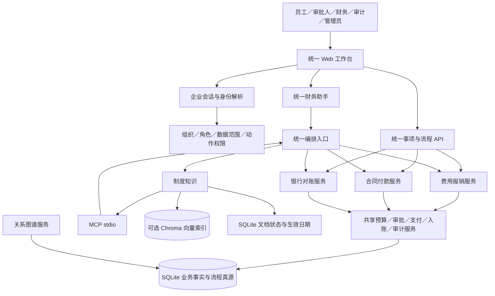

# Finance RAG Agent — 统一企业财务智能平台（合成演示）

在原有 RAG、Tool Calling、RAGAS、知识图谱、权限与审计骨架上，整合为一个统一财务工作台。费用报销、合同付款、银行对账、预算控制、制度知识、关系图谱和变更管理共用同一入口、同一组织权限和同一业务数据库。

**全部文档、人员、账户和业务记录均为合成演示数据。** 支付、入账、组织变更和制度发布只作用于本地演示环境，不连接真实企业 OA、银行或记账系统。

## 1. 平台能力

这不是把多个场景塞进一个聊天框，而是以统一事项为中心的财务业务平台：

- **统一门户与待办**：工作总览、我的申请、当前待办、异常事项和流程时间线来自同一套 `work_items / tasks / workflow_events`。
- **费用报销闭环**：申请、费用计算、制度校验、部门审批、财务审核、预算预留、退补、模拟支付、模拟入账和关闭。
- **合同付款闭环**：合同、里程碑、验收、发票、供应商账户和预算预检；审批、退补、模拟付款、模拟凭证和归档留痕。
- **银行对账闭环**：按账户或全量运行批次，生成差异事项；会计提交处理说明，财务负责人复核后关闭。
- **制度 RAG 嵌入业务**：制度查询、单据预检和事项详情返回条款依据；检索按知识权限、文档状态和生效日期过滤。
- **预算控制**：进入预算节点时冻结，退回或撤销时释放，补件后重新预留，支付时由冻结转为已发生，防止重复占用。
- **OA 式组织权限**：用户、部门、岗位、汇报关系、角色、数据范围、动作权限和职责分离共同决定可见性与可执行动作。
- **关系图谱**：从 SQLite 明确关系确定性地生成供应商—合同—里程碑—验收—发票—付款—凭证等链路，用于解释和追溯，不负责金额计算。
- **变更管理**：离职停用、待办接管、调岗与角色变化、供应商状态和风险、预算调整、制度版本发布均保留前后快照。

### 统一编排与受控场景能力

对外只有 **1 个统一财务助手和 1 个统一编排入口**，内部调用 4 类受控能力：制度知识、费用报销、合同付款、银行对账。预算、审批、支付、入账、权限和审计仍由确定性共享服务执行。

当前编排采用确定性路由和 Tool Calling 式服务调用，不是让 LLM 自主决定审批或付款。金额、预算、匹配、状态流转和权限均由程序与 SQLite 约束完成；在线模式下，千问只依据已检索制度生成知识回答。企业助手只读，业务写入必须在对应表单或事项中按权限执行。

## 2. 核心模块

| 模块 | 当前实现 |
| --- | --- |
| 统一工作台 | 无外部前端依赖的 HTML/CSS/JavaScript 单页应用；总览、业务办理、对账、图谱、变更管理和财务助手；适配桌面与手机 |
| 企业身份 | 通过 `session_id` 从 SQLite 派生用户、部门、职级和当前角色，不信任企业接口前端自报的 `user_role` 或职级 |
| 工作流 | 审批、退回、补件、重新提交、撤销、支付、入账、差异处理、复核和关闭；保留处理人、版本和完整事件 |
| 知识工程 | 显式目录、PDF/TXT 解析、清洗、条款切分、标签、版本、权限、来源路径和 SHA-256 血缘 |
| 制度检索 | 默认离线中文 bigram／拉丁 token／IDF-BM25 风格评分；可选 DashScope Embedding + Chroma、本地 BGE 精排和千问生成 |
| 付款预检 | 合同状态与审批、里程碑金额、发票、验收、质保期、供应商状态、账户指纹和风险复核 |
| 银行对账 | 交易号匹配，以及金额、总账缺失、银行未达、重复流水、重复总账、币种、日期和账户差异分类 |
| 工程保障 | SQLite 事务与 `BEGIN IMMEDIATE`、乐观版本、幂等请求哈希、支付与凭证唯一约束、权限越界和状态流转测试 |
| MCP | 6 个 FastMCP stdio 工具，与统一平台共用知识和业务数据库；保留旧写入工具的显式确认门 |
| 历史实验骨架 | 保留原 RAG、Tool Calling、RAGAS 和知识图谱实验代码及历史记录，不改写未重跑的指标 |

## 3. 系统架构



PDF／TXT／JSON／CSV 是合成来源或文件证据；SQLite 保存业务事实、流程状态、权限和审计；JSONL／Manifest 是知识中间产物；Chroma 只保存语义索引；图谱由数据库明确关系生成，不另建一套业务事实。

## 4. 演示数据规模

| 数据 | 初始规模 |
| --- | ---: |
| 部门／角色／用户 | 5／9／15（含 1 名默认停用用户） |
| 初始统一事项 | 22：18 条报销 + 4 条合同付款流程 |
| 知识文档 | 14：10 份 PDF + 4 份 TXT |
| 统一知识 Chunk | 101 |
| 供应商／合同／合同里程碑 | 12／12／36 |
| 付款申请／发票／验收 | 24／20／8 |
| 文件证据 | 10 条附件登记，含合成发票、验收单及 SHA-256 |
| 预算项目／预算申请 | 8／8 |
| 银行流水／总账记录 | 120／120 |
| 全量对账结果 | 113 笔匹配、7 项差异 |
| `CNY-OPER-002` 对账结果 | 59 条银行、59 条总账、56 笔匹配、2 项差异 |

报销种子覆盖已关闭、已支付、待支付、部门审批、财务审核、财务负责人复核、预算审批和退补等状态。付款包含缺验收、里程碑金额不一致和供应商账户不一致等异常。知识目录含 2 份归档旧版制度和 1 份待发布差旅 V3；未生效或已归档版本不参与当前检索。

初始 `tickets`、运行时支付、运行时凭证、对账批次、动作请求和变更记录均为 0。演示操作会增加这些记录；需要恢复初始状态时重建 SQLite。

## 5. 快速开始

建议使用 Python 3.11 或 3.12。默认离线模式不需要 API Key、向量模型、GPU 或 Docker。

### Windows PowerShell

```powershell
py -3.12 -m venv .venv
.\.venv\Scripts\Activate.ps1
python -m pip install -r requirements.txt
python scripts/build_finance_db.py
$env:FINANCE_OFFLINE_DEMO="true"
python -m uvicorn api:app --host 127.0.0.1 --port 8000
```

### Linux／macOS

```bash
python3.12 -m venv .venv
source .venv/bin/activate
python -m pip install -r requirements.txt
python scripts/build_finance_db.py
export FINANCE_OFFLINE_DEMO=true
python -m uvicorn api:app --host 127.0.0.1 --port 8000
```

打开：

- `http://127.0.0.1:8000/`：统一工作台，主验收入口；
- `http://127.0.0.1:8000/health`：数据规模、检索模式和向量索引状态；
- `http://127.0.0.1:8000/docs`：API 调试文档。

`python agent_ui.py` 也会启动同一工作台。默认 `/health` 应显示 `offline_demo=true`、`retrieval_mode=lexical`；未构建真实向量索引时，`vector_index_ready=false` 是正常状态。

## 6. 演示账号

页面通过选择模拟用户建立会话，无真实账号密码。常用账号如下：

| 用户 | 用户 ID | 角色与用途 |
| --- | --- | --- |
| 林晓 | `U-EMP-001` | 普通员工；新建报销、本人申请和补件 |
| 陈宇 | `U-EMP-002` | 研发部员工；组织与角色变更演示 |
| 周宁 | `U-EMP-003` | 采购专员；合同付款申请、PR-002 补件与预检 |
| 王衡 | `U-MGR-SCM` | 供应链部负责人；部门审批 |
| 唐准 | `U-MGR-SCM-BACK` | 供应链部副负责人；部门待办接管 |
| 赵祺 | `U-MGR-RD` | 研发部负责人；研发部门审批 |
| 孙岚 | `U-FIN-REVIEW` | 财务共享审核员；财务初审 |
| 谢审 | `U-FIN-REVIEW-BACK` | 财务共享复核员；审核待办接管 |
| 刘芃 | `U-FIN-BP` | 财务 BP；预算审批与冻结 |
| 何谨 | `U-FIN-HEAD` | 财务负责人；高额复核、对账复核、预算调整和制度发布 |
| 郑安 | `U-TREASURY` | 出纳；模拟支付 |
| 罗会 | `U-ACCOUNTANT` | 会计；模拟入账、运行对账和提交差异处理 |
| 顾言 | `U-AUDITOR` | 审计员；读取业务与审计信息，无业务审批权 |
| 系统管理员 | `U-ADMIN` | 组织、供应商和制度管理；默认不因此获得业务事项查看权 |
| 苏离 | `U-LEAVER` | 默认停用用户；不能建立新会话 |

## 7. 角色化演示剧本

以下路径均已在浏览器中实际验收。为让编号、待办和金额与说明一致，建议先停止服务并执行 `python scripts/build_finance_db.py`，再启动服务。变更管理和闭环演示会修改本地数据；需要重复演示时重新建库即可。

### 7.1 新建报销与退补

1. 选择 **林晓**，进入“业务办理 → 发起差旅报销”。
2. 填写 **深圳、2 天、住宿每晚 450 元**，点击“计算并提交审批”。
3. 预期：住宿 450 + 伙食 300 + 市内交通 160 = **910 元**；职级来自林晓的当前身份“普通员工”；新事项进入 `pending_department`，处理人为王衡。
4. 返回初始数据后，打开林晓的 **BX-2026-016**，填写补件说明并重新提交；预期从 `needs_supplement` 回到 `pending_finance_review`，补件与异常处理进入时间线。

### 7.2 合同付款完整闭环

使用初始 **PR-001**：

| 顺序 | 操作用户 | 动作 | 预期结果 |
| ---: | --- | --- | --- |
| 1 | 孙岚 | 财务初审通过 | `pending_finance_review → pending_budget` |
| 2 | 刘芃 | 预算审批通过 | 建立预算预留并增加冻结金额，进入 `pending_payment` |
| 3 | 郑安 | 模拟支付 | 冻结转已发生，生成唯一模拟支付记录，进入 `pending_accountant` |
| 4 | 罗会 | 模拟入账 | 生成唯一模拟凭证，事项进入 `closed` |

在事项详情中可查看审批事件、预算预留、支付和凭证。重复提交相同动作会命中幂等或唯一约束；使用旧版本号操作会返回 409 冲突。

### 7.3 新建合同付款

1. 选择 **周宁**，进入“业务办理 → 提交合同付款”。
2. 选择 **PR-019**，点击“预检并进入流程”。
3. 预期：申请金额 **135000 元**，无预检异常，进入 `pending_department`；处理人为王衡，并因金额超过 50000 元标记需要财务负责人复核。
4. 再次提交同一申请会被拒绝，不能生成重复流程。

### 7.4 银行对账与差异复核

1. 选择 **罗会**，进入“对账中心”，账户选择 `CNY-OPER-002`，运行批次。
2. 预期：59 条银行流水、59 条总账，**56 笔匹配、2 项差异**；系统生成独立批次和差异待办。
3. 打开 **BK-004 重复流水**差异，填写处理说明并提交；预期进入 `pending_verification`。
4. 切换 **何谨**，复核通过；预期事项 `closed`，异常状态已解决，原批次和处理历史仍保留。

选择“全部账户”运行时，预期为 **113 笔匹配、7 项差异**。每次运行都会生成新批次，不覆盖历史批次。

### 7.5 关系图谱与越权拦截

- 使用周宁或财务角色查询 **PR-001**：可查看供应商、合同、里程碑、发票、付款申请、支付和凭证等可见关系；点击合同节点可继续追溯。
- 使用林晓查询 **PR-001**：应返回 403 和“无权查看该事项关系图谱”。该 403 是预期权限拦截，不是页面故障。
- 图谱只解释数据库明确关系；费用、预算和对账金额仍由确定性服务计算。

### 7.6 组织、主数据与制度变更

可分别演示，完成后重建数据库再演示下一项：

- **离职接管**：系统管理员停用孙岚，接管人选择谢审；原会话立即失效，未关闭待办转交，历史审批不删除。
- **调岗与角色**：系统管理员调整用户部门或追加角色；新数据范围和动作权限立即生效，角色历史保留。
- **供应商风险**：将 V-009 改为 `frozen / high`；后续付款预检读取新状态，变更前后快照进入 `change_events`。
- **预算调整**：何谨将 FIN-2026 年度预算由 150000 调整为 160000，并填写原因；新年度预算不能低于已承诺、已发生和已冻结之和。
- **未来制度**：发布 `POL-TRAVEL-2027-V3-0`，生效日期为 2027-01-01；当前检索仍使用 V2.1，未来日期检索使用 V3。新文档必须先完成目录登记、清洗和索引，不能只在页面中凭空发布。

### 7.7 统一财务助手

| 当前用户 | 输入 | 预期 |
| --- | --- | --- |
| 林晓 | 普通员工在一类城市的住宿费用上限是多少 | 返回 500 元/晚及当前制度引用 |
| 周宁 | 请预检付款申请 PR-002 | 返回“缺少验收单”及工具轨迹 |
| 林晓 | 请预检付款申请 PR-002 | 403，不能查看他人付款事项 |
| 罗会 | 执行对账分析 CNY-OPER-002 | 只读返回 56 笔匹配、2 项差异及中文异常说明 |

助手用于知识解释、只读预检和分析。审批、退补、支付、入账与主数据写入由相应业务控件执行，避免通过自然语言绕过权限和流程。

## 8. 企业 API 与兼容接口

### 主接口

| 接口 | 用途 |
| --- | --- |
| `GET /enterprise/users` | 获取模拟用户和当前角色 |
| `POST /enterprise/session` | 建立或复用企业会话；同一编号不能绑定不同用户 |
| `GET /enterprise/workspace` | 可见事项、我的待办、我的申请和可提交付款 |
| `GET /enterprise/items/{item_id}` | 事项详情、业务数据、证据、预算、事件和允许动作 |
| `POST /enterprise/expenses` | 以当前身份职级计算并创建报销流程 |
| `POST /enterprise/payments/{request_id}/submit` | 预检并提交本人付款申请 |
| `POST /enterprise/items/{item_id}/actions` | 审批、退回、补件、撤销、支付、入账或差异处理 |
| `POST /enterprise/reconciliation/runs` | 创建对账批次及差异事项 |
| `POST /enterprise/assistant` | 企业权限下的统一只读助手 |
| `GET /enterprise/graph` | 查询权限范围内的确定性关系图谱 |
| `GET /enterprise/admin-data` | 变更管理数据与前后快照 |
| `POST /enterprise/changes/...` | 用户、供应商、预算和制度变更 |
| `GET /enterprise/changes` | 查询变更记录 |
| `GET /health` | 健康、数据规模和运行模式 |

流程动作必须携带 `expected_version` 和 `idempotency_key`。常见错误映射：权限不足为 403，版本或幂等冲突为 409，记录不存在为 404，参数或状态规则错误为 400。

### 旧契约

`POST /agent`、`POST /ask` 和 `POST /agent/execute` 为原项目及 Dify 联调保留。`/agent` 的旧演示角色入参和“确认后创建合成工单／报销”确认门仅属于兼容链路，不是新企业工作台的权限模型；新企业助手调用时禁止旧聊天写入旁路。

## 9. 知识、业务库与向量索引

### 从当前提交的合成来源重置业务库

```bash
python scripts/build_finance_db.py
```

该命令删除并重建 `data/finance_demo.db`，清除本地会话、流程动作、支付、凭证、对账批次、旧兼容工单和变更记录，恢复 22 个初始统一事项。

### 从生成器完整重建合成来源

```bash
# 仅重新生成 PDF 时需要开发依赖
pip install -r requirements-dev.txt

# 重建基础 PDF／JSON／CSV、目录和知识产物
python scripts/generate_demo_corpus.py

# 扩充组织、报销、合同付款、附件与对账数据
python scripts/generate_enterprise_data.py

# 用扩充后的来源完成最终 SQLite 重建
python scripts/build_finance_db.py
```

只重建知识管线：

```bash
python -m finance_platform.ingestion
```

`data/catalog.json` 是唯一文档入口，管线不会扫描未登记文件。Chunk 和 Manifest 包含 `document_id`、版本、状态、权限、来源路径、解析／清洗／切分器及 SHA-256，支持血缘追溯。

### 可选在线 Chroma 向量 RAG

1. 复制配置，并只在本地 `.env` 填入真实 Key：

   ```bash
   cp .env.example .env  # Windows 使用 copy .env.example .env
   ```

2. 配置：

   ```text
   DASHSCOPE_API_KEY=你的真实Key
   FINANCE_OFFLINE_DEMO=false
   FINANCE_RETRIEVAL_MODE=vector
   FINANCE_EMBEDDING_MODEL=text-embedding-v2
   FINANCE_LLM_MODEL=qwen-plus
   FINANCE_GENERATION_ENABLED=true
   ```

3. 构建统一向量索引并重启 API：

   ```bash
   python scripts/build_vector_store.py
   python -m uvicorn api:app --host 127.0.0.1 --port 8000
   ```

向量记录使用统一 `chunk_id`，Metadata 带版本、状态、权限和血缘字段。运行时还会读取 SQLite `document_states`，按当前或指定 `as_of` 日期过滤；待发布、归档和不在有效区间的版本不会混入回答。

若存在 `models/BAAI--bge-reranker-v2-m3/snapshots/master`，且 `FINANCE_ENABLE_RERANK=true`，会加载本地 BGE 精排；不需要精排时设为 `false`。切换 Embedding 模型后必须重建 `chroma_db/unified`。无 Key、索引未构建或外部服务未验收时，应使用离线模式，不把降级结果描述为在线语义检索。

### 数据分工

| 位置 | 职责 |
| --- | --- |
| `knowledge/`、`data/raw/` | 合成制度、组织、业务来源和文件证据 |
| `data/curated/` | 解析、清洗、Chunk 和 Manifest 血缘产物 |
| `data/finance_demo.db` | 业务事实、统一事项、流程、权限、预算、对账、支付、凭证和审计真源 |
| `chroma_db/unified/` | 统一知识的 Chroma 向量索引，不保存业务交易 |
| `logs/` | 原 RAG／历史 Agent JSONL 审计；统一业务写入审计进入 SQLite |

SQLite 数据库、Chroma 索引、本地 `.env` 和模型目录均不提交 Git。

## 10. MCP stdio 联调

核心依赖已包含 MCP 及兼容的 Starlette／SSE 版本，安装 `requirements.txt` 后运行：

```bash
python mcp_server/test_mcp_client.py
```

Server 提供：

- `query_finance_policy`
- `check_payment_request`
- `check_budget_request`
- `analyze_reconciliation`
- `get_document_lineage`
- `create_finance_ticket`

前 5 个为只读工具；`create_finance_ticket` 未显式传入 `confirmed=true` 时只返回 `confirmation_required`，确认后写旧兼容 `tickets` 表。MCP 默认只开放 `employee,manager` 通道，预算和对账另要求经理权限；审计不保存完整敏感 Payload。

## 11. 原实验骨架与历史结果

以下能力保留原代码，不与新统一平台的确定性编排混为一谈：

- `main.py`：原 RAG 实验主链路，包含权限过滤、限流和模型降级；
- `agent_main.py` / `agent_tools.py`：原差旅 Tool Calling 循环与业务标准库工具；
- `kg_extract.py` / `build_kg.py`：原千问三元组抽取、NetworkX 建图和 pyvis 可视化；新企业关系图谱位于 `finance_platform/graph.py`，直接读取 SQLite 明确关系；
- `evaluate.py` / `eval_dataset.py`：原 20 条分层 RAGAS 评估集与评估流程。

原 RAGAS 历史记录如下，本次统一平台改造没有重新运行这些外部模型实验，也不新增或改写指标：

| 生成策略 | 忠实度 | 答案相关度 | 检索精度 | 检索召回 |
| --- | ---: | ---: | ---: | ---: |
| 思考模型（v1） | 0.9639 ¹ | 0.4956 | 0.8585 | 0.8500 |
| 非思考小模型（v2） | 0.8488 | 0.5111 | 0.8669 | 0.9000 |
| 关思考旗舰（原最终选型） | 0.8594 | 0.5546 | 0.8756 | 0.9250 |

¹ v1 忠实度为剔除 4 条错误拒答（NaN）后的均值。上述数值只对应原评估链路，不是新统一平台的在线验收结果。

## 12. 权限、安全与边界

| 角色 | 典型数据范围 | 典型动作 |
| --- | --- | --- |
| 普通员工 | 本人事项 | 申请、补件、撤销、本人单据预检 |
| 部门负责人 | 本部门及本人待办 | 部门审批、退回 |
| 财务共享审核员 | 财务可见范围 | 财务初审、退回 |
| 财务 BP | 财务可见范围 | 预算审批、冻结 |
| 财务负责人 | 财务可见范围 | 高额复核、对账复核、预算调整、制度发布 |
| 出纳 | 财务可见范围 | 待支付事项的模拟支付 |
| 会计 | 财务可见范围 | 模拟入账、对账批次与差异处理 |
| 审计员 | 审计读取范围 | 查看事项、图谱和变更记录，不获得业务审批权 |
| 系统管理员 | 系统管理 | 组织、供应商和制度管理；默认业务事项列表为空 |

- 企业 API 根据服务端会话获取当前身份；角色变化、调岗和停用会影响后续权限与待办。
- 申请人与审批／处理人职责分离；当前处理人必须同时匹配用户和当前角色。
- 检索和动作执行均采用 fail-closed 思路；历史流程事件、任务、异常、支付、凭证和变更记录不因组织变化而删除。
- API Key 只走本地 `.env` 或环境变量，不得提交、截图分享或写入代码。
- 真实企业文档接入前必须另行完成授权、分类分级、脱敏和来源登记，不要提交到本仓。
- 当前会话是模拟身份机制，不等于企业 SSO；真实部署仍需接入企业认证、密钥管理、审计保留策略及真实业务系统。

## 13. 验证状态

```bash
python -m unittest discover -s tests -v
python mcp_server/test_mcp_client.py
```

本次已实际完成：

- **24 组自动化测试通过**：12 组原平台契约 + 12 组企业平台测试；覆盖语料与血缘、10 条制度金标准、权限与版本过滤、复杂付款、预算、120/120 对账、身份数据范围、职责分离、完整流程、退补、幂等、旧版本冲突、离职接管、主数据变更、图谱、企业 API 和 Chroma 契约。
- **真实 MCP stdio 协议测试通过**：发现 6 个工具并完成 6 次协议调用；全量对账结果为 113 笔匹配、7 项差异。
- **真实浏览器验收通过**：报销退补、PR-001 审批至关闭、PR-019 新建、CNY-OPER-002 对账及 BK-004 复核关闭、图谱与越权拦截、组织／供应商／预算／制度变更、新建报销和统一助手。
- **桌面与 390px 手机布局验收通过**：逐页检查总览、业务、对账、图谱、变更管理和助手；正常操作无 JavaScript 错误，无横向溢出；弹窗按钮、Esc 和遮罩关闭可用。
- 交付前重新构建 SQLite，运行时演示写入不进入 Git。

必须保留的边界：

- Chroma 自动化测试使用 `FakeEmbeddings`，只证明索引写入、读取、权限过滤和版本过滤契约，**不证明真实语义检索质量**。
- DashScope 真实 Embedding、在线 Chroma 检索、BGE 精排和千问生成尚未用真实 Key 重新验收。
- Dify 配套仓的旧 `/agent` 请求字段仍可进行基本只读联调；新 DSL 仍待实际 Dify 实例导入和运行验收。
- LoRA 配套仓仅保留种子数据和校验脚本；未把新增数据写成已训练，也未产生新训练结果。
- 浏览器验收是在开发沙箱完成，不等于每位使用者的 Windows 本地环境已验收。

## 14. 目录结构

```text
.
├── api.py                    # 统一 Web、企业 API、健康检查与旧兼容接口
├── agent_ui.py               # 统一工作台启动器
├── static/index.html         # 统一事项工作台
├── finance_platform/
│   ├── orchestrator.py       # 统一编排与只读场景路由
│   ├── workflow.py           # 报销／付款／对账闭环、预算、幂等与状态流转
│   ├── enterprise_database.py# 组织、会话、统一事项、任务、权限和审计
│   ├── changes.py            # 组织、供应商、预算和制度变更
│   ├── graph.py              # SQLite 明确关系图谱
│   ├── policy_search.py      # 离线／在线制度检索、权限和生效日期过滤
│   └── ...                   # 知识工程、场景规则、向量与数据服务
├── mcp_server/               # FastMCP Server 与真实 stdio 协议测试
├── scripts/                  # 合成语料、企业数据、业务库和向量库构建脚本
├── tests/                    # 24 组自动化测试
├── data/raw/                 # 合成 PDF、JSON、CSV 与文件证据
├── data/curated/             # parsed、cleaned、chunks、manifest
├── data/labels/              # 10 条制度检索金标准
├── knowledge/                # 4 份合成 TXT，含差旅 V3 待发布版本
├── main.py                   # 原 RAG 实验主链路
├── agent_main.py             # 原差旅 Tool Calling 实验骨架
├── kg_extract.py             # 原知识图谱三元组抽取
├── evaluate.py               # 原 RAGAS 评估
├── docs/                     # 原安全专项材料
├── models/                   # 本地 Reranker，不入库
└── requirements*.txt
```

## License

MIT
